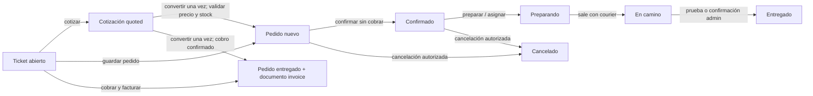

# Diseño técnico del centro operativo de ventas Flutter

Fecha: 2026-11-03. **Propuesta, sin implementación.** Se basa en la auditoría hermana [AUDITORIA-PWA-PEDIDOS-COTIZACIONES-DELIVERY.md](AUDITORIA-PWA-PEDIDOS-COTIZACIONES-DELIVERY.md). La PWA existente es la referencia visual. Las pantallas Flutter deben conservar su lenguaje de color, iconografía y densidad, con adaptación a Windows, Android e iPhone; no se propone copiar FullPOS Cloud. El backend continúa siendo la autoridad para precio, permisos, transiciones, cobro, stock e idempotencia.

## Objetivo operativo y límites

`WhatsApp → cliente → ticket o cotización → productos → entrega/retiro → pedido → pago → documento → repartidor → cierre comercial y económico`.

El empleado debe poder hacer el recorrido con una sola venta abierta y pasos compactos. Cada paso confirma al servidor solo el hecho que corresponde. No se automatiza una notificación, cobro, factura o liquidación por abrir una pantalla. Antes de implementar, el responsable del backend debe confirmar la revisión desplegada en UAT y las políticas comerciales todavía no documentadas.

## Modelo unificado: una entidad por hecho

| Entidad | ID y vínculo | Fuente de verdad hoy | Estado independiente |
|---|---|---|---|
| Cliente y conversación | `customer.id`, `conversation.id`, `conversation.customer_id`, `company_id` | `customers`, `conversations`; `wa_messages` | Atención/chat; no representa pedido. |
| Ubicación | `location.id`, `customer_id`, `conversation_id`, `wa_message_id`, `source` | `locations`; snapshot `order.delivery.location` con `source_location_id` | Válida/seleccionada para este pedido; no reemplazar historial. |
| Ticket/borrador | `ticket_<hash>`, `requestId`, `actor_id`, `version`, `draft.customerId`, `draft.conversationId` | SQL `fulltech_pos_tickets_v1` | `open → processing → completed` o `open → discarded`; nunca venta ni reserva. |
| Cotización | `pos_documents.id`, `kind=quote`, `customer_id`, `order_id` tras conversión | `pos_documents` | `quoted → converted`; revisar `processing/failed` al recuperar. Vigencia y edición publicada no verificadas. |
| Pedido | `order.id`, `order_number`, `customer_id`, `conversation_id`, `company_id` | `ctx.store`/`orderJson` y proyección operativa | Comercial (`nuevo`, `confirmado`, `preparando`, `en_camino`, `entregado`, `cancelado`, `perdido`). |
| Pago | `payment.entries[].id`, `idempotency_key`, `order.id` | `order.payment` y `order.payment_status` | `pending`, `partial`, `paid`, `void`; transferencia declarada puede seguir por verificar. |
| Venta y documento | Pedido entregado/pagado según hechos; `invoice_id`, `invoice_number`, `pos_documents.id` si checkout factura | `orders` y `pos_documents`; recibo del pedido separado | Documento `processing/completed/failed`; facturación fiscal/e-CF **sin integración verificada**. |
| Entrega | `order.delivery.lifecycle`, courier, `delivery_events.order_id`, snapshot de ubicación | `orderJson` + `delivery_events` | Logístico; no usar como indicador de pago. |
| Efectivo y rendición | `order.id`, movimientos de custodia, `payment.courier.handovers[]` | `delivery_cash` y `order.payment` | Cobrado, por rendir, rendido, conciliado; independiente de remuneración. |
| Remuneración | Tarifa aprobada y cálculo futuro por asignación | Hoy `settings.delivery_rate` y `earningsFor` fijo por entrega | Devengado/ajustado/liquidado; diseño futuro sujeto a política. |

**Referencias cruzadas y deduplicación.** El ticket guarda `quoteId` cuando nace de una cotización. Checkout guarda `ticketId` y `ticketVersion`; la cotización guarda `order_id` al convertirse. `requestId` debe ser estable para un intento de checkout y su huella impedir reutilizarlo con otro contenido. La entrega usa `delivery_events.idempotency_key` y versión de pedido; cobros y rendiciones usan claves propias. No reutilizar la clave de ticket como clave de pago. Ante timeout de checkout, conservar operación, leer ticket, documento y pedido por sus ID y mostrar «Resultado por confirmar» hasta reconciliar. No repetir automáticamente.

## Estados y transiciones

La máquina de reparto actual en `server/delivery-lifecycle.mjs` permite `ASSIGNED/OFFERED → ACCEPTED → PICKED_UP → EN_ROUTE → ARRIVED → DELIVERED`, con atajos autorizados (`start` incluye recogida; `EN_ROUTE → DELIVERED`) y salidas `REJECTED`, `EXPIRED`, `CANCELLED`, `REASSIGNED`. Los estados comerciales derivados no sustituyen el ciclo logístico. La app Delivery transforma estos estados en su enum de presentación mediante `crm_courier_adapter.dart`. Nunca interpretar `delivered` de una interfaz como pago o rendición.

**Ejes económicos paralelos.** Pago `pending → partial → paid` solo por entradas confirmadas; una transferencia declarada pasa por `pending verification → verified/rejected`. Documento `none → processing → completed` o `failed/uncertain`. Custodia `sin cargo → efectivo bajo custodia → rendición parcial/completa → conciliación`. Liquidación del courier permanece separada. Cada eje necesita fecha, actor y origen visibles en el detalle.

## Navegación propuesta, reutilizando pantallas existentes

1. **Chat, una acción «Crear pedido» y otra «Crear cotización».** Resolver `conversationId`, `customerId` y empresa de la conversación; mostrar nombre y teléfono antes de abrir POS. `ChatOptionsPanel` ya tiene «Crear pedido», pero hoy navega sin payload (`chat_screen.dart:1408-1411`). Ajustar `crm_shell.dart` y `PosScreen` para recibir contexto tipado y no solo el nombre de pestaña.
2. **Selector de trabajo existente.** Consultar tickets `open` del cliente (`GET /api/admin/pos/tickets`) y pedidos abiertos (`GET /api/admin/pos/context/:id`). Si hay uno, ofrecer «Continuar ticket», «Abrir pedido existente» o «Crear nuevo»; con varios, selector con número, fecha, importe y estado. Los pedidos cerrados jamás se reabren como borrador. Si no hay ticket, crearlo en el backend con `requestId` estable antes de presentar continuidad como garantizada. Un doble clic comparte la misma operación en curso.
3. **Ventas/POS, paso Productos.** Precargar cliente, teléfono, conversación, último contexto confiable y líneas si se continúa ticket/cotización. Mantener buscador, categorías, cantidades, descuentos sujetos a permisos y totales calculados localmente solo como vista previa. Guardado de ticket con versión; respuesta 409 pide recargar, no pisar cambios. Opción Cotizar reutiliza `/api/admin/pos/quotes`.
4. **Paso Entrega.** Retiro o delivery; selector de ubicaciones del expediente con fuente y fecha, mapa/confirmación de coordenadas, dirección y referencia. Evitar pedir datos ya presentes; permitir corregirlos. El pedido copia snapshot de la ubicación elegida. Mostrar costo de envío separado del precio de productos. Si no hay ruta/posición fiable, no exhibir una distancia calculada como si fuera tarifa validada.
5. **Paso Confirmar.** Resumen con subtotal, descuento, envío, total, importe recibido y saldo, método, tipo de documento y acción explícita. «Guardar pedido» deja pago independiente. «Cobrar y facturar» se permite solo con cobro confirmado y entrega inmediata según contrato actual. `expectedTotal` en centavos y `requestId` inmutables en el envío. Si aparece un pedido abierto, exigir confirmación de venta nueva.
6. **Detalle del pedido.** Reutilizar `PedidoDetailScreen`/`PedidoActions` para confirmar, asignar courier, enviar oferta, observar aceptación, prueba de entrega, pago y custodia. Navegar al mismo `orderId` tras guardar; no recrear el pedido al continuar el reparto. Cotización vuelve a su documento y PDF; envío WhatsApp requiere acción visible del operador.

En PC, mantener conversación y editor disponibles mientras se abre un panel de venta compacto; en 1280×720 y 1366×768 usar el espacio útil sin scroll horizontal, y en 1920×1080 limitar anchuras de lectura. En móvil, secuencia breve con vuelta atrás al ticket persistente. El frente visual tiene dueño propio según `docs/TRABAJO-PARALELO.md`: coordinar antes de editar Chat, POS, Pedidos o `crm_repository.dart`.

## Delivery: tarifa al cliente frente a remuneración

**Situación verificada.** El checkout recibe `deliveryFee` entero; el servidor lo valida y lo incorpora al total. La remuneración actual visible en `delivery-cash.mjs::earningsFor` multiplica un `rateCents` fijo por entregas y, si falta tarifa aprobada, devuelve «pendiente de configurar». `POST /api/admin/delivery-rate` permite escribir esa cifra a administración. Esto no demuestra tramos, zonas, kilometraje ni snapshot de pago por pedido. No se fijan valores nuevos aquí.

**Contrato que requiere ampliación, sujeto a la política vigente y al dueño del backend.** Definir configuración versionada y por empresa para cobro al cliente: fijo, zona, tramo de kilómetros, distancia de ruta y cobertura máxima; y configuración separada para pago base al courier, tramos/km, comisiones condicionadas y excepciones autorizadas. El servidor debe decidir método de distancia (ruteo vial con proveedor, versión de ruta, resultado y timestamp; si no disponible, revisión manual). La distancia lineal solo puede ser aproximación informativa, nunca cobrar como ruta. Al confirmar/asignar, guardar snapshot inmutable de tarifa, versión, entrada geográfica, método, importe al cliente, remuneración propuesta, actor y excepción. Un cambio posterior de tarifas no recalcula pedidos asignados sin ajuste auditado. No descontar automáticamente la remuneración del efectivo recibido por el repartidor. El diseño del endpoint y del esquema se acordará con el responsable del backend después de confirmar políticas regionales; no se inventa una ruta en esta fase.

**Operación de reparto.** CRM administra; Delivery ejecuta. Reutilizar las rutas `/api/admin/orders/:id/courier/assign`, `/courier/send`, `/api/courier/orders/:id/:event`, `/api/courier/location`, `/api/admin/delivery-courier-positions`, seguimiento y custodia. Mostrar oferta enviada, aceptación/rechazo, recogida, ruta, llegada, prueba y confirmación con su propio estado; no avisar al cliente dos veces. La app Delivery aporta coordenadas solo con entrega activa y autorización. La ausencia de GPS debe verse como «última posición desconocida» con hora, no como ubicación actual. El historial se lee del backend, no de fixtures.

## Contratos a conservar y ampliaciones propuestas

| Necesidad | Reutilización inmediata | Ampliación a negociar, sin nueva ruta propuesta |
|---|---|---|
| Chat → venta | `customerId`, `conversationId`, `pos/context`, `pos/tickets` | Canal seguro para pasar contexto en Flutter y filtrar tickets por cliente/empresa del lado servidor; validar permisos del actor. |
| Cotización | `pos/quotes`, PDF, `quoteId` en checkout | Vigencia explícita, revisión/edición autorizada de oferta publicada y estado de expiración, si el negocio lo aprueba. |
| Precio/stock | `calculateSale`, `expectedTotal`, `checkOrder`, `ensureInventoryForSale` | Confirmar en UAT el momento exacto de reserva/descuento y cómo se informa al usuario. |
| Pago/documento | `payments`, verificación admin, recibo e invoice PDF | Aclarar regla fiscal con responsable contable; no etiquetar el PDF actual e-CF. Crédito solo si existe autorización verificable. |
| Tarifas/courier | `delivery_rate`, `delivery_fee`, asignación, posición, custodia | Políticas versionadas y snapshots separados; distancia vial comprobable, remuneración y liquidación auditables. |

## Riesgos y decisiones antes de programar

- La copia de trabajo contiene cambios sin commitear y el backend compartido está asignado a otra sesión. No reemplazar archivos ni reiniciar procesos. Integrar por bloques coordinados.
- `PosScreen` puede abrirse con cotización; el nuevo contexto de chat no debe borrar ese modo. Definir precedencia: cotización explícita > ticket elegido > chat nuevo.
- Un ticket puede pertenecer a otro actor. La UI no debe prometer continuidad hasta que el servidor autorice lectura/escritura. Las respuestas 403/404/409 son estados operativos, no invitación a crear duplicado.
- La PWA conserva borrador en `localStorage` y en SQL; Flutter usa ticket SQL. Un borrador local PWA no sincronizado no estará disponible en Flutter. Mostrar «solo en este dispositivo» cuando proceda, sin fusionar silenciosamente.
- Transferencia, imagen o texto de WhatsApp no son prueba de ingreso. El estado `operation_pending` exige consulta y revisión.
- La empresa del pedido debe derivarse del cliente y contexto autenticado, no de una selección de UI sin verificación. Costos, ganancias y comisiones respetan `cost.view` y permisos administrativos.
- No existe respaldo localizado para emisión fiscal electrónica. Cualquier cambio de comprobante necesita revisión contable/legal específica antes de implementación.

## UAT con datos ficticios (plan, no ejecutado)

| Caso | Resultado aceptable |
|---|---|
| Dos clics en Crear pedido; reinicio de app con ticket | Un ticket/operación, mismo cliente y conversación tras reinicio. |
| Cliente con varios tickets y pedidos abiertos | Selector distingue ambas clases; continuar no crea pedido nuevo. |
| Convertir dos veces cotización desde dos sesiones | Un solo `order_id`; segunda solicitud duplica resultado o recibe conflicto recuperable. |
| Precio nuevo o stock insuficiente antes de confirmar | 409/422 legible, ticket intacto, ningún cobro duplicado. |
| Desconexión después de enviar checkout o pago | Resultado incierto, consulta por ID; nunca reenvío ciego. |
| Pago parcial y transferencia declarada sin verificar | Saldo correcto y pedido no marcado pagado por declaración. |
| Repartidor rechaza, oferta vence o se reasigna | Pedido sigue vivo; eventos, avisos y responsable se actualizan una vez. |
| GPS ausente/erróneo y tarifa cambia | No tarifa de ruta falsa; snapshot anterior permanece, excepción requiere actor. |
| Incidencia, código incorrecto y confirmación administrativa | Entrega no se cierra indebidamente; intento y resolución auditados. |
| Rendición parcial, comisión y reintento de cierre | Custodia y remuneración separadas; sin doble movimiento ni compensación tácita. |
| Roles y dos empresas | Operador ve solo datos autorizados; courier no ve pedido ajeno; costo oculto sin `cost.view`. |
| Diseño 1280×720, 1366×768, 1920×1080 y móvil | Pasos, totales y acciones accesibles; no pérdida de editor ni contenido. |

## Plan por bloques y criterios de aceptación

1. **Bloque A, contexto y tickets.** Coordinar propietarios de Chat/POS/Repositorio; pasar IDs desde chat, cargar expediente, filtrar/seleccionar tickets y pedidos abiertos, preservar versión. Aceptación: doble clic y reinicio recuperan el mismo ticket, sin pedido adicional ni mezcla de empresa.
2. **Bloque B, flujo POS y cotización.** Unificar pasos Productos/Entrega/Confirmar y cotización con backend existente, revisar diferencias PWA/Flutter. Aceptación: quote → PDF → envío manual → conversión única; cambio de precio/stock bloquea de forma recuperable.
3. **Bloque C, pedido, pago y documento.** Detalle único tras checkout, estados separados, verificación de transferencia y tratamiento de operación incierta. Aceptación: saldos, permisos y documento correctos, sin etiquetado fiscal no respaldado.
4. **Bloque D, Delivery y custodia.** Validar asignación, aceptación, GPS, prueba, incidencia y rendición con la app nativa; después pactar contrato versionado de tarifas/remuneración. Aceptación: un pedido atraviesa ambos clientes sin IDs nuevos; custodia coincide con efectivo realmente recibido, comisión separada.
5. **Bloque E, UAT y pulido visual.** Datos ficticios, matriz anterior, tres resoluciones Windows y móviles, comparación con PWA y coordinación de sesiones. Aceptación: ninguna regresión de PWA ni de permisos, evidencias de backend y Delivery, cero operaciones financieras reales.

Cada bloque se implementará solo después de acordar el anterior y su dueño. En esta entrega no se ejecutó ningún caso UAT, migración, cambio de backend, commit ni deploy.
