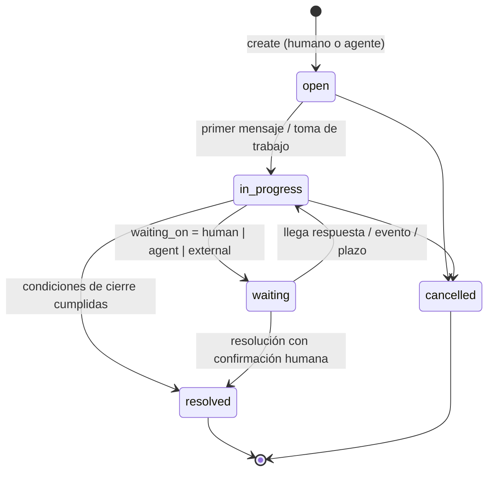
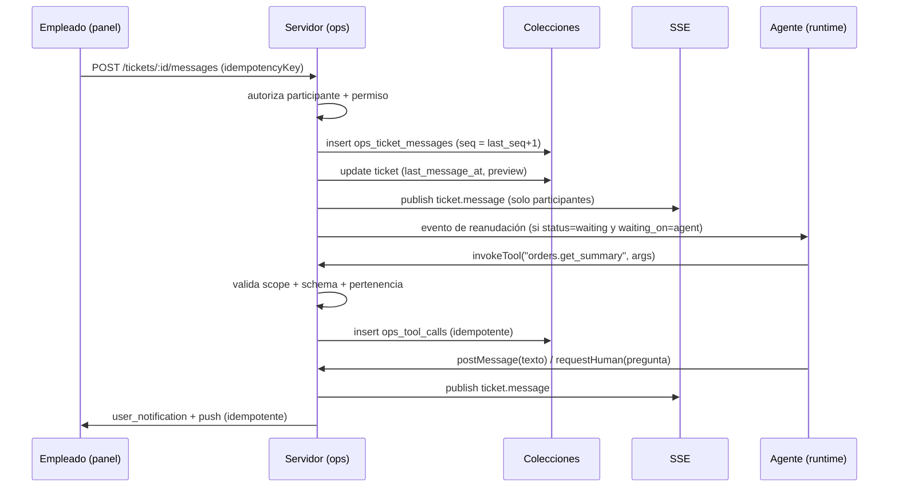

# Centro de Operaciones IA — Etapa A (auditoría + arquitectura)

> **Estado:** ETAPA A — documento de arquitectura. **No se ha modificado código.**
> Nada de esto está desplegado, ni commiteado, ni empujado.
> Fecha: 2026-10-21 · Árbol de trabajo: `main` en `e1c7108` (= `origin/main`) **con cambios sin commitear de otra línea de trabajo**.

---

## 0. Alcance, reglas de seguridad y qué NO se toca

| Regla | Cumplimiento en esta etapa |
|---|---|
| No modificar producción | Solo se generó este documento en `docs/`. |
| No desplegar / no push / no merge | No se ejecutó git de escritura. |
| Preservar trabajo sin commitear | `git status` auditado y documentado (§1.9). No se tocó ni se revirtió ningún archivo. |
| No alterar el chat de WhatsApp del cliente | Sin cambios en `public/admin/app.js` (chat), `wa-lista.css`, `wa-desktop.css`, `composer-mobile.css`, `server/customers.mjs`, `server/whatsapp.mjs`. |
| No modificar pedidos ni mensajes históricos | El diseño es **solo aditivo**: colecciones nuevas y rutas nuevas. |
| No infraestructura nueva | Se reutilizan scheduler, SSE, notificaciones y auditoría existentes (§2). |
| Datos de prueba aislados | UAT sobre `data/uat/*.sqlite`, nunca Postgres de producción. |

**Módulo nuevo e independiente:** `AI Operations Center` = *tickets internos + conversación operativa*.
No es un chatbot del cliente, no es una pantalla más del supervisor de delivery y no reutiliza las
conversaciones de WhatsApp del cliente como espacio de trabajo interno.

---

## 1. Auditoría de la arquitectura existente

### 1.1 Proceso y despliegue

- **Un solo proceso Node** (`server/crm-server.mjs`, ~12.400 líneas) dentro del contenedor
  `ventas_phytoemagrywed`, junto a nginx (que sirve `dist/` y hace proxy de `^~ /api/` y `^~ /admin/`
  a `127.0.0.1:8787`). Swarm con **1 réplica**.
- Arranque y cableado en `startCrmServer(config)`; el enrutado del panel es una cadena `if (route === …)`
  dentro de un único handler. Las rutas modulares nuevas ya usan el patrón inverso:
  `await handleXRoute({ req, res, route, ctx, actor, json, readJson, can })` (POS, tienda, proveedores).
  **El Centro de Operaciones seguirá ese patrón modular**, no la cadena gigante.
- Pruebas: `startCrmServer({ port: 0, host, dataFile: <temp>.sqlite, token, quiet, whatsapp: <mock>, clock })`.
  El reloj es inyectable (`ctx.clock()`), lo que permite UAT de plazos sin esperar.

### 1.2 Almacenamiento

Dos capas, ambas ya multi-backend (Postgres / SQLite / JSONL):

1. **`server/stores.mjs`** → pedidos legacy y plantillas (`phytoemagry_items`).
2. **`server/collections.mjs`** → almacén de documentos uniforme. Es la pieza clave del diseño nuevo.

Hechos verificados de `collections.mjs` que condicionan el modelo de datos:

- Lista **cerrada** `COLLECTIONS`: una colección nueva debe declararse ahí o `schemaOf()` lanza
  «colección desconocida».
- Prefijo de tabla `phytoemagry_` (configurable), tablas `id` + `doc` (JSONB) + **columnas indexadas**
  extraídas del documento.
- Migración automática: `ALTER TABLE ADD COLUMN IF NOT EXISTS` / `PRAGMA table_info`, con
  `expectedColumns()` para detectar tablas preexistentes de otro esquema.
- **Índices únicos = idempotencia** (`customers.phone_e164`, `wa_messages.wa_message_id`,
  `followups.idempotency_key`, `scheduled_messages.idempotency_key`, `delivery_supervision_events.idempotency_key`,
  `user_notifications.idempotency_key`, `push_jobs.idempotency_key`, `order_pickups.idempotency_key`…).
  `insert()` devuelve `{ duplicate: true }` cuando choca.
- API del contexto: `ctx.db.insert | update | list | findBy | count` (`list` admite `{ by, order, limit }`).
- **GOTCHA SQLite:** `node:sqlite` no enlaza booleanos → las columnas indexadas guardan `0/1`; el documento
  conserva el booleano.
- **GOTCHA:** `store.listAdmin()` es **síncrono** en SQLite → nunca `.then()`.

Ya existen colecciones reutilizables en el mismo almacén: `settings`, `audit`, `user_notifications`,
`push_subscriptions`, `push_jobs`, `notification_deletions`, `delivery_supervision_events`,
`delivery_tracking_sessions`, `locations`, `order_pickups`, `supplier_invoices`, `warranty_claims`.

### 1.3 Identidad, roles y permisos

- Usuarios en `crm_users` (`id`, `username`, `display_name`, `role`, `active`, hash PBKDF2).
- Roles **cerrados**: `ADMIN | AGENT | DELIVERY | OPERADOR` (`USER_ROLES`).
- Permisos **cerrados** por rol (`ROLE_PERMISSIONS`), comprobados con `hasPermission(actor, 'x')`;
  ADMIN tiene `*`. **No existe permiso por usuario ni override.**
- Sesión: cookie `pe_crm` = `exp.HMAC(base64url, PHYTO_CRM_TOKEN)`; también hay sesiones con id en
  `crm_sessions` (revocables; cambiar el rol revoca sesiones).
- **Hallazgo relevante para la Fase 7:** el usuario del CRM **no tiene teléfono**. Los contactos de
  reparto viven en un ajuste (`savedCourierContacts`), no en `crm_users`. Por tanto *mapear WhatsApp ↔
  empleado* exige una colección nueva con verificación explícita.

### 1.4 Tiempo real

`server/realtime.mjs`:

- **Un solo SSE** `GET /api/admin/events` por pestaña, con `?since=<seq>` / `Last-Event-ID` y evento
  `resync` si el cursor es más viejo que el búfer.
- Lista **cerrada** `REALTIME_TYPES` (`order.*`, `delivery.*`, `pickup.*`, `payment.*`, `inventory.changed`,
  `customer.updated`, `supervisor.changed`, `whatsapp.message_received`).
- `eventFromMutation()` publica **solo si la respuesta fue 2xx** (después de persistir).
- El evento **no lleva datos privados**: dice *qué* cambió y *qué* volver a pedir.
- Filtrado por permiso y por pertenencia (`clientAccepts`), con permisos **vivos** (getters) y heartbeat
  que corta el canal si la sesión se revoca.
- Suscriptores **en memoria**: correcto con 1 réplica; con varias habría que pasar a Postgres
  `LISTEN/NOTIFY`. Se documenta como condición de escalado (§9).

### 1.5 Scheduler (durabilidad ya resuelta)

`server/scheduler.mjs` ya implementa exactamente las garantías que pide la Fase 5:

- Cola **persistente** en `scheduled_messages` (no `setTimeout`).
- **Idempotencia doble**: `idempotency_key` única + **reclamo por transición de estado**
  (`SCHEDULED → PROCESSING` con token).
- `recoverStale()` devuelve a la cola las filas que quedaron «Processing» (`DEFAULT_STALE_MS` = 5 min).
- Guard `running` para que dos pasadas no se solapen.
- El mismo tick ejecuta `deliveryControlTick` y `deliverySupervisorTick`.
- `PHYTO_CRM_NO_SCHEDULER=1` apaga el bucle (necesario cuando dos instancias miran la misma base).

**Conclusión de la Fase 5 (investigación pedida):** no hace falta Temporal, Redis ni ningún orquestador
externo. El patrón «cola persistente + lease + recuperación de huérfanos + idempotencia» ya está probado
en producción en este proyecto. El Centro de Operaciones añade **un tick más** al scheduler existente.

### 1.6 Supervisor IA de Delivery (primer agente a integrar)

`server/delivery-supervisor.mjs` (≈1.600 líneas) ya resuelve, para su dominio:

- Motor **determinista** (`supervisionOf`, `supervisorTick`) — no depende del modelo.
- Bitácora `delivery_supervision_events` con `idempotency_key` **única**: recordatorios, escalamientos,
  posposiciones y conciliación diaria no se duplican.
- Ajustes en `settings.delivery_supervisor`, con `activationMode: 'new'` + `activatedAt` (sin activar no
  escribe nada) y límites por pasada.
- LLM (DeepSeek) vía `ctx.proofreading.interpret()`: **solo PROPONE intención**, se descarta si no está
  en la lista blanca `SUPERVISOR_INTENTS` o si la confianza < 0,6.
- **El texto del repartidor es DATO, no instrucción** (defensa anti prompt-injection ya aplicada).
- `handleSupervisorReply()` se llama **antes** de `handleCourierInbound` en el webhook; si no reconoce
  remitente/intención, cae en la máquina histórica del courier.

Esto es, literalmente, el contrato de agente que la Fase 4 pide generalizar. **Se generaliza, no se
reescribe.**

### 1.7 Notificaciones

- `user_notifications`: `recipient_user_id`, `type`, `entity_type/entity_id`, `deep_link`, `status`
  (`unread|read`), `idempotency_key` **única**.
- `push_subscriptions` + `push_jobs` (idempotente) → Web Push real ya funcionando.
- `notification_deletions`: **tombstones en servidor** por usuario e `event_key` (borrar en el teléfono
  no resucita el aviso desde otro dispositivo).
- Envío externo por WhatsApp ya existe con ventana de 24 h (`canSendFreeText`), plantillas aprobadas y
  límites anti-duplicado (p. ej. `ASSIGNMENT_NOTICE_WINDOW_MS` = 5 min, uno por conversación).

**Regla que se hereda:** la notificación es un *aviso*; la **fuente de verdad es el ticket** (§7 de la misión).

### 1.8 Frontend

- Una sola página `public/admin/index.html` + `app.js` (~26.000 líneas) + hojas CSS que se **pisan por
  orden** (la última gana).
- Navegación: `VIEWS` (lista cerrada, `app.js` ≈ línea 22.574) + `VIEW_SUBTITLE` + `setTab()` +
  `<section class="view" id="view-…" hidden>` + evento `fulltech:tab`.
- **Patrón ya probado para módulos nuevos:** vista `supervisor` → `public/admin/supervisor.js` (ESM),
  escucha `fulltech:tab`, se protege en `setTab`, `app.js` solo la registra en `VIEWS`/`VIEW_SUBTITLE`.
  Estilos en `supervisor.css`, cargados tras las hojas base.
- Tema claro/oscuro: `:root[data-theme='dark']` (cuenta como clase) → los bloques oscuros propios deben
  repetir el ancla completa (`:root[data-theme='dark'] body[data-tab='ops'] …`).
- PWA: `sw.js` con `VERSION` y cache-busting `?v=`; subir ambos al tocar el armazón.
- Offline: `offline.js` (red primero, copia como respaldo), `sync-engine.js`, `offline-ui.js`.

**Riesgo conocido:** `tests/panel-whatsapp.test.js` compara la **lista exacta de `setInterval`** del panel
(para que nadie añada un temporizador que envíe solo). Cualquier sondeo nuevo obliga a actualizar ese test.

### 1.9 Estado de Git (auditado, sin tocar)

`main` = `origin/main` = `e1c7108`. Árbol **sucio** con trabajo de otra línea (galería de productos,
tienda pública, IA de respuesta):

- Modificados (20): `package.json`, `package-lock.json`, `public/admin/{index.html,offline.js,proofreading.js,store.css,store.js,sw.js}`,
  `public/store/{index.html,store.js,sw.js}`, `server/{proofreading.mjs,store-catalog-routes.mjs,store-catalog.mjs,store-public-routes.mjs}`,
  y 7 archivos de `tests/`.
- Sin seguimiento (9): `docs/QA-GALERIA-PRODUCTOS.md`, `docs/QA-PRODUCTO-COMPACTO.md`,
  `public/admin/product-editor.css`, `public/store/product-gallery.{css,js}`,
  `tests/{ai-smart-reply,product-gallery-ui,product-gallery}.test.js`.

**Ninguna etapa de este plan requiere tocar esos archivos**, salvo `public/admin/index.html` y `sw.js`
(dos líneas de registro y el `VERSION`) en la Etapa B. Se hará con edición quirúrgica y se avisará antes.

### 1.10 Lo que NO existe (y por tanto hay que construir)

- Ningún ticket interno, ninguna conversación interna, ningún participante.
- Ningún registro de agentes ni de ejecuciones de workflow.
- Ningún registro de herramientas/invocaciones de agente.
- Ninguna identidad de empleado para WhatsApp (los usuarios no tienen teléfono).
- Permisos de dominio `tickets.*` / `agents.*`.
- Tipos de evento SSE para tickets.

---

## 2. Reutilizar vs construir (evitar duplicados)

| Necesidad | Decisión | Pieza |
|---|---|---|
| Persistencia de tickets/mensajes/ejecuciones | **Reutilizar** | `server/collections.mjs` (`COLLECTIONS` + `ctx.db`) |
| Trabajo diferido / reanudación durable | **Reutilizar** | `server/scheduler.mjs` (un tick más) |
| Reclamo y recuperación tras reinicio | **Reutilizar** | patrón `SCHEDULED→PROCESSING` + `recoverStale` |
| Avisos en el panel | **Reutilizar** | `user_notifications` + `deep_link` |
| Push al móvil | **Reutilizar** | `push_subscriptions` / `push_jobs` |
| Traza de negocio | **Reutilizar** | `server/audit.mjs` (`AUDIT_ACTIONS`, ampliar) |
| Actualización en vivo | **Reutilizar** | `server/realtime.mjs` (`REALTIME_TYPES`, ampliar) |
| Filtrado por permisos y sesión viva | **Reutilizar** | `clientAccepts` + getters de `permiso` |
| Motor determinista + LLM que solo propone | **Reutilizar patrón** | `delivery-supervisor.mjs` + `proofreading.interpret` |
| Ventana de 24 h de WhatsApp | **NO aplicar** | el chat interno no es WhatsApp: no hay ventana ni plantillas |
| Segundo bus de eventos / segunda cola / segundo sistema de avisos | **NO construir** | sería duplicación |
| Orquestador externo | **NO construir** | sin justificación (§1.5) |

---

## 3. Diseño técnico

### 3.1 Bounded context

```
server/ops/
  tickets.mjs        reglas de ticket (tipos, estados, dedupe, numeración, proyección por permisos)
  messages.mjs       mensajes internos (seq por ticket, idempotencia, lectura/acuse)
  participants.mjs   autorización de participantes y contadores no leídos
  routes.mjs         rutas del panel (/api/admin/ops/*) con `can(...)`
  agents.mjs         registro de agentes y scopes de herramientas
  runtime.mjs        máquina de pasos durable (claim, lease, reanudación, recuperación)
  tools.mjs          registro CERRADO de herramientas + validación de argumentos
  approvals.mjs      aprobación humana (solicitud, decisión, reanudación)
  notify.mjs         puente a user_notifications / push / (opt-in) WhatsApp empleado
  agent-api.mjs      API servidor-a-servidor para agentes externos (credencial de agente)
```

`crm-server.mjs` solo añade **una línea de delegación**:

```js
if (await handleOpsRoute({ req, res, route, ctx, actor, json, readJson, can })) return;
```

`ctx` ya expone lo necesario (`db`, `users`, `realtime`, `clock`, `proofreading`, `customers`, `store`).

### 3.2 Ciclo de vida del ticket



- `status` (cerrado): `open | in_progress | waiting | resolved | cancelled`.
- `waiting_on` (solo si `status='waiting'`): `human | agent | external`.
- **Estados de persona separados del estado del ticket:**
  `delivered → read → acknowledged → completed`. Leer **nunca** completa nada (Fase 6).

### 3.3 Flujo de una conversación interna



### 3.4 Rutas del panel (`/api/admin/ops/*`)

Todas exigen sesión y `can('tickets.*')`. **Ninguna** devuelve datos fuera de la proyección autorizada.

| Método y ruta | Permiso | Notas |
|---|---|---|
| `GET /inbox?filter=&q=&cursor=` | `tickets.read` | Lista con contadores no leídos, sin cuerpo de mensajes |
| `POST /tickets` | `tickets.create` | `idempotencyKey` obligatoria; dedupe por `active_key` |
| `GET /tickets/:id` | participante o `tickets.read_all` | Ticket + participantes + primera página de timeline |
| `PATCH /tickets/:id` | `tickets.update` | Estado, prioridad, plazo, asignación |
| `GET /tickets/:id/messages?afterSeq=` | participante | Paginación por `seq` |
| `POST /tickets/:id/messages` | `tickets.reply` | `idempotencyKey` obligatoria |
| `POST /tickets/:id/read` | participante | `{seq}` → `last_read_seq` |
| `POST /tickets/:id/ack` | participante | `{seq, note}` → acuse **separado** de la lectura |
| `POST /tickets/:id/complete` | `tickets.update` | Marca *tarea* completada; no cierra el ticket |
| `POST /tickets/:id/resolve` | `tickets.close` | Exige `checklist` cumplida |
| `POST /tickets/:id/participants` | `tickets.participants.manage` | Añadir/quitar participante |
| `GET /agents`, `POST /agents`, `PATCH /agents/:id` | `agents.manage` | Solo ADMIN |
| `GET /runs/:id` | `agents.manage` | Diagnóstico de ejecución |
| `POST /runs/:id/approve` | `tickets.approve` | Aprobación humana; reanuda el run |

### 3.5 API de agente (servidor a servidor, nunca con cookie del panel)

Base `/api/ops/agent/*`, autenticación por **credencial de agente** (`agent_key` + HMAC o token rotado,
guardado cifrado como ya se hace con la clave de DeepSeek), IP/uso irrelevante porque el agente corre
**dentro** del servidor o en una extensión autorizada.

```
POST /api/ops/agent/runs/claim          → reclama el siguiente run elegible (lease)
GET  /api/ops/agent/runs/:id/context    → ticket + mensajes + entidades permitidas (proyección)
GET  /api/ops/agent/tools               → catálogo de herramientas permitidas a ESTE agente
POST /api/ops/agent/runs/:id/tools/:name→ invoca herramienta (args validados)
POST /api/ops/agent/runs/:id/messages   → escribe mensaje interno
POST /api/ops/agent/runs/:id/wait       → deja el run en espera con motivo y plazo
POST /api/ops/agent/runs/:id/complete   → resultado / recomendación de cierre
POST /api/ops/agent/runs/:id/fail       → error registrado (reintentable o no)
```

Reglas duras:

1. El agente **nunca** recibe un cliente de base de datos. Solo estas funciones.
2. Toda escritura exige `idempotencyKey`; el servidor deduplica.
3. `context` se **proyecta por permisos del agente** (sin teléfonos ni direcciones si su scope no lo incluye).
4. El agente no puede cambiar su scope, ni crear tickets de tipos no permitidos, ni cerrar tickets de riesgo alto.

### 3.6 Runtime durable (Fase 5)

- `ops_workflow_runs` es la unidad durable: `status`, `state` (JSON), `attempt`, `next_run_at`,
  `lease_owner`, `lease_until`, `idempotency_key` **única**.
- Un **tick** del scheduler llama `opsRuntimeTick()` (igual que hoy llama al supervisor):
  1. `recoverStale()` → runs con `lease_until` vencido vuelven a `pending` (máx. `attempts`).
  2. Toma runs elegibles (`status in (pending, waiting)` y `next_run_at <= now`) con **lease**.
  3. Ejecuta **un paso** por tick (acotado), lo registra en `ops_workflow_steps` y decide el siguiente estado.
  4. Libera el lease.
- **Idempotencia de paso:** `step_key = run:<id>:<n>` **única** → un reintento no repite el efecto.
- **No depende del navegador**: el panel es solo un visor.
- **Concurrencia segura**: lease + guard `running` del scheduler. Con más de una réplica, el claim pasa a
  `SELECT … FOR UPDATE SKIP LOCKED` en Postgres (documentado, no necesario hoy).

---

## 4. Modelo de datos (adiciones a `COLLECTIONS`)

Todas las colecciones son **nuevas**; ninguna existente cambia de esquema. Prefijo físico `phytoemagry_`.

```js
/* 1. TICKETS */
ops_tickets: {
  indexed: {
    number: 'text',              // TK-XXXXXX (único)
    type: 'text',                // order|delivery|incident|assignment|sales_followup|inventory|admin|agent_task
    entity_type: 'text', entity_id: 'text',
    status: 'text',              // open|in_progress|waiting|resolved|cancelled
    waiting_on: 'text',
    priority: 'text',            // low|normal|high|urgent
    assigned_user_id: 'text', assigned_agent_id: 'text',
    parent_ticket_id: 'text',
    due_at: 'text', follow_up_at: 'text',
    last_message_at: 'text',
    active_key: 'text',          // dedupe: <type>:<entity_type>:<entity_id>:<workflow>  (null si cerrado)
    created_at: 'text',
  },
  unique: ['number', 'active_key'],
}

/* 2. MENSAJES INTERNOS */
ops_ticket_messages: {
  indexed: {
    ticket_id: 'text', seq: 'text',
    author_type: 'text',         // user|agent|system|tool
    author_id: 'text',
    kind: 'text',                // text|system|tool_result|approval_request|approval_decision|attachment
    client_key: 'text',          // idempotencia del cliente
    created_at: 'text',
  },
  unique: ['client_key'],
}

/* 3. PARTICIPANTES (autorización + estados por persona) */
ops_ticket_participants: {
  indexed: {
    ticket_id: 'text', participant_type: 'text', participant_id: 'text',
    role: 'text',                // owner|assignee|watcher|requester
    last_read_seq: 'text', last_ack_seq: 'text',
    created_at: 'text', idempotency_key: 'text',
  },
  unique: ['idempotency_key'],   // part:<ticket>:<type>:<id>
}

/* 4. LÍNEA DE TIEMPO ESTRUCTURADA (transiciones, acuses, tool calls) */
ops_ticket_events: {
  indexed: { ticket_id: 'text', kind: 'text', actor_id: 'text', created_at: 'text', idempotency_key: 'text' },
  unique: ['idempotency_key'],
}

/* 5. AGENTES */
ops_agents: {
  indexed: { key: 'text', enabled: 'text', kind: 'text', updated_at: 'text' },
  unique: ['key'],               // delivery_supervisor, sales_assistant, …
}

/* 6. EJECUCIONES DURABLES */
ops_workflow_runs: {
  indexed: {
    ticket_id: 'text', agent_key: 'text', workflow_key: 'text',
    status: 'text',              // pending|running|waiting_human|waiting_event|succeeded|failed|cancelled
    next_run_at: 'text', lease_owner: 'text', lease_until: 'text',
    idempotency_key: 'text', created_at: 'text', updated_at: 'text',
  },
  unique: ['idempotency_key'],   // run:<ticket>:<agent>:<workflow>:<n>
}

/* 7. PASOS (append-only, idempotentes) */
ops_workflow_steps: {
  indexed: { run_id: 'text', step_key: 'text', status: 'text', created_at: 'text' },
  unique: ['step_key'],          // run:<id>:<n>
}

/* 8. INVOCACIONES DE HERRAMIENTA */
ops_tool_calls: {
  indexed: {
    run_id: 'text', ticket_id: 'text', tool: 'text', status: 'text',
    requires_approval: 'text', approval_message_id: 'text',
    idempotency_key: 'text', created_at: 'text',
  },
  unique: ['idempotency_key'],   // tool:<run>:<step>:<name>
}

/* 9. IDENTIDAD DE EMPLEADO PARA CANALES EXTERNOS (Fase 7) */
ops_employee_channels: {
  indexed: { user_id: 'text', channel: 'text', phone_e164: 'text', status: 'text', created_at: 'text' },
  unique: ['idempotency_key'],   // ch:<user>:<channel>:<phone>
}
```

### 4.1 Decisiones de modelado que evitan problemas reales

- **Dedupe sin duplicar activos:** `active_key` se rellena solo mientras el ticket está activo y se pone a
  `null` al cerrar. Postgres y SQLite permiten **muchos NULL** en un índice único → un pedido puede tener un
  ticket abierto y, más tarde, otro nuevo, pero **nunca dos activos del mismo flujo**.
- **Idempotencia de mensajes:** `client_key` única generada por el cliente (`<ticket>:<uuid>`) → un doble
  toque, un reintento de red o un reenvío del agente no duplican nada.
- **`seq` por ticket:** contador en el documento del ticket (`last_seq`), incrementado en el proceso con
  mutex por ticket (`Map<ticketId, Promise>`). Ordena el hilo sin depender de la resolución de `created_at`
  ni del reloj. Si algún día hay varias réplicas, se sustituye por `SELECT … FOR UPDATE`.
- **No se reutiliza `wa_messages`.** El chat interno no comparte tabla con WhatsApp del cliente: evita que
  cualquier consulta del hilo del cliente vea mensajes internos (aislamiento por diseño, no por `WHERE`).
- **Numeración** `TK-XXXXXX` con el mismo generador de 6 hex que los pedidos (`PE-XXXXXX`) y unicidad real
  por índice, con reintento acotado ante colisión.
- **Proyección, no filtrado posterior:** `ticketProjectionFor(actor)` construye el objeto con los campos
  permitidos. Nunca se envía el documento completo y se recorta en el cliente.

### 4.2 Migración y compatibilidad

- **Solo aditivo**: `CREATE TABLE IF NOT EXISTS` + columnas indexadas nuevas. Ninguna tabla existente cambia.
- Riesgo real ya documentado en este repo: una tabla con el **mismo nombre y otro esquema** hace que el DDL
  se descarte en silencio (`phytoemagry_messages` legacy, incidente del 30/09/2026). Mitigación: nombres con
  prefijo `ops_` (sin colisión con nada existente) y `expectedColumns()` ya lo verifica al arrancar.
- Rollback de esquema = borrar las tablas `phytoemagry_ops_*` (no hay dependencias con datos históricos).
- Producción es **Postgres**; las pruebas locales son **SQLite**. Toda consulta nueva se valida en ambos.

---

## 5. Diseño de interfaz y navegación

### 5.1 Dónde vive

- Vista nueva `ops` → `<section class="view" id="view-ops" hidden>` en `index.html`,
  registrada en `VIEWS` / `VIEW_SUBTITLE` (`app.js`) y protegida en `setTab`.
- Módulo propio `public/admin/ops.js` (ESM) que escucha `fulltech:tab` — **mismo patrón que `supervisor.js`**.
  Objetivo: **no engordar `app.js`** (26.000 líneas con escritores concurrentes).
- Hoja propia `public/admin/ops.css` cargada **la última** y con todo el estilo bajo `body[data-tab='ops']`
  y el prefijo `.ops-`. **No se reutilizan clases de `wa-lista.css`/`wa-desktop.css`** para garantizar que
  el chat del cliente no puede romperse por un cambio aquí (y viceversa).
- Entrada de menú: grupo **Operación** del drawer → «Centro IA», con badge de no leídos
  (`data-drawer-badge`, ya soportado).

### 5.2 Bandeja (inbox)

Layout de dos columnas en escritorio (lista 380–420 px + hilo), una sola columna en móvil con navegación
lista ↔ hilo (misma lógica que `body[data-wa-view]`, pero con atributo propio `data-ops-view`).

- Cabecera compacta: título «Centro de operaciones», buscador y selector de filtros.
- Filtros (chips en una fila con `overflow-x` y `min-height` explícito — GOTCHA ya visto en `#wa-filters`):
  `Todos · Abiertos · Esperando respuesta · Esperando agente · Míos · Sin asignar · Urgentes · Resueltos`.
- Fila (72 px, un solo bloque de 3 líneas): avatar/tipo, número + título, asignado · prioridad · estado,
  vista previa del último mensaje, hora y **badge de no leídos**.
- Indicadores: `🤖` agente asignado, `⏰` plazo vencido, `✋` esperando persona, `✓` acuse pendiente.

### 5.3 Conversación

- Cabecera (60 px): volver, `TK-XXXXXX`, título en una línea con `text-overflow`, chips de estado y
  prioridad, menú `⋯` (asignar, prioridad, plazo, participantes, resolver).
- Burbujas: entrantes/salientes del lado humano igual que el chat del cliente (fondo, radio 8–12, 14,2/19 px),
  y **estilos distintos y no ambiguos** para:
  - **mensaje de IA** (borde izquierdo + etiqueta `IA · <agente>`),
  - **evento del sistema** (fila centrada, gris, sin burbuja),
  - **resultado de herramienta** (bloque colapsable con icono y resumen, nunca JSON crudo),
  - **solicitud/aprobación humana** (tarjeta con dos botones y motivo).
- Separadores de fecha; estado por mensaje: enviado/entregado interno, leído y **acuse explícito** (distintos).
- Compositor compacto: textarea autoalto, `Enter` envía / `Shift+Enter` salto, adjuntar (reutiliza
  `media-pipeline`), botón de acuse rápido.
- Panel lateral derecho en escritorio (`≥980px`): «Ticket» (tipo, entidad vinculada, plazos, participantes,
  línea de tiempo de estados) y «Ejecuciones» (runs del agente, solo con `agents.manage`). En móvil, hoja
  inferior con `data-ops-panel='ticket'`.
- **Cero tarjetas grandes y cero espacio muerto:** `100dvh`, filas de 44–72 px, `--ops-*` tokens.

### 5.4 Tema y móvil

- Claro y oscuro completos. Bloque oscuro propio con ancla completa
  (`:root[data-theme='dark'] body[data-tab='ops'] …`) para ganar a `shell-v2-tema.css`.
- Seguro para notch: `env(safe-area-inset-*)` en cabecera y compositor (patrón de `MENUS_SAFE_AREA`).
- Compositor con `visualViewport` (`--ops-viewport-height/top`) para no quedar bajo el teclado.
- Objetivo medido: 390×844 y 1440×900; sin `overflow-x`; último mensaje siempre visible.

---

## 6. Contrato de integración de agentes (reutilizable)

### 6.1 Principios

1. **Modelo independiente.** El runtime no asume LLM. Un workflow puede ser 100% determinista (como el
   supervisor actual) o usar proveedor (DeepSeek hoy, otro mañana) tras una interfaz común `ctx.ai`.
2. **Sin acceso libre a datos.** Solo herramientas registradas con scope y validación.
3. **El contenido es DATO.** Ni mensajes ni adjuntos se convierten en instrucciones o llamadas.
4. **Acciones de alto impacto requieren confirmación humana.**
5. **Todo se registra**: cada paso, cada herramienta y cada decisión quedan en colecciones append-only.

### 6.2 Registro de herramientas (cerrado, ampliable por PR)

Cada herramienta declara: `name`, `schema` (validación estricta), `permission` requerida, `side_effect`
(`read | write | high_impact`), `idempotent` y `scopes` de datos.

Primer lote (Etapa D):

| Herramienta | Efecto | Permiso | Aprobación |
|---|---|---|---|
| `tickets.get_context` | read | `tickets.read` | no |
| `orders.get_summary` | read | `orders.read` | no |
| `tickets.post_message` | write | `tickets.reply` | no |
| `tickets.request_human` | write | `tickets.reply` | no |
| `tickets.request_ack` | write | `tickets.reply` | no |
| `tickets.set_follow_up` | write | `tickets.update` | no |
| `tickets.escalate` | write | `tickets.escalate` | no |
| `delivery.postpone` | high_impact | `delivery.tracking.manage_all` | **sí** (existente) |
| `orders.confirm` | high_impact | `orders.update_operational` | **sí** |
| `inventory.adjust` | high_impact | `inventory.adjust` | **sí** |

Una herramienta inexistente o fuera del scope del agente ⇒ **rechazo** (`unknown_tool` / `tool_not_allowed`),
nunca «se intenta y se ve».

### 6.3 Aprobación humana

`high_impact` ⇒ el runtime **no ejecuta**: escribe un mensaje `approval_request` + `user_notification` +
`run.status='waiting_human'`. Un humano con `tickets.approve` pulsa Aprobar/Rechazar
(`POST /runs/:id/approve`). Solo entonces el run se reanuda y ejecuta **una** vez (idempotente).

### 6.4 Anti prompt-injection (Fase 9)

- El runtime **no** ejecuta nada que venga del texto libre. Si hay LLM, su salida se interpreta como
  **propuesta de intención**, se valida contra la lista blanca (`OPS_INTENTS`, análoga a `SUPERVISOR_INTENTS`)
  y se exige confianza mínima (≥ 0,6, ya usado hoy).
- Los argumentos de herramienta se validan contra el schema y contra la **pertenencia** (el pedido del ticket
  es el del ticket; nunca «el que diga el texto»).
- Adjuntos: solo metadatos + `sniffMime`; **no** se ejecutan, no se abren rutas del sistema y no se
  interpretan como instrucciones.
- Instrucciones del sistema **no** viajan al cliente ni a otros agentes.

### 6.5 Contrato del primer agente (Delivery Supervisor)

El supervisor actual se adapta **sin reescribir su motor**:

1. Cada pedido con reparto elegible obtiene/crea su ticket (`type='delivery'`, `entity_type='order'`).
2. El tick existente, además de sus eventos, escribe mensajes internos en ese ticket (recordatorio,
   escalamiento, respuesta del repartidor, posposición, conciliación).
3. `handleSupervisorReply()` sigue decidiendo; si la respuesta del repartidor llega **por el ticket**, se
   reutiliza la misma lógica de intención.
4. El ticket **no se resuelve** hasta que se cumplan las condiciones de cierre (entrega completada + cobro
   conciliado, o decisión humana explícita).

---

## 7. Hitos (implementación incremental)

| Etapa | Contenido | Criterio de salida |
|---|---|---|
| **A** (esta) | Auditoría, arquitectura, modelo de datos, riesgos | Este documento revisado y aprobado |
| **B** | Colecciones base (1–4), rutas de ticket y mensajes, **bandeja + conversación** premium, permisos, aislamiento | Crear/leer/escribir tickets con persistencia real; UI en claro/oscuro, móvil y escritorio; pruebas verdes en SQLite y Postgres |
| **C** | Participantes, `read`/`ack`/`complete`, notificaciones internas + push, dedupe y contadores | Leer ≠ acusar ≠ completar comprobado; sin duplicados con doble envío |
| **D** | Agentes (registro, runtime durable, herramientas, aprobaciones, API de agente, recuperación, identidad de empleado para WhatsApp **opt-in**) | Reinicio a mitad de run sin perder ni duplicar; herramienta de alto impacto bloqueada hasta aprobar |
| **E** | Integración del Supervisor de Delivery + UAT de los 20 puntos + evidencia visual | E2E con pedidos ficticios y verificación en base de datos |

**Nada de D ni E se implementa sin la aprobación explícita de A.** Cada etapa es un cambio revisable por
separado; ninguna etapa incluye deploy.

---

## 8. Plan de pruebas (Fase 10 → por etapa)

| # | Caso | Etapa |
|---|---|---|
| 1 | Ticket manual | B |
| 2 | Ticket ligado a un pedido | B |
| 3 | Abrir la conversación del ticket | B |
| 4 | Empleado ↔ empleado | B |
| 5 | Agente ↔ empleado | D |
| 6 | Respuesta del empleado a la IA | D |
| 7 | Reanudación del workflow | D |
| 8 | Confirmación de lectura | C |
| 9 | Acuse explícito | C |
| 10 | Cambios de estado | B/C |
| 11 | Seguimiento de reparto | E |
| 12 | Escalamiento | E |
| 13 | Reinicio del backend | D |
| 14 | Evento duplicado | C/D |
| 15 | Mensajes concurrentes | C |
| 16 | Sin conexión / reconexión | C/E |
| 17 | Acceso no autorizado | B/C |
| 18 | Varios agentes en un ticket | D |
| 19 | Claro / oscuro | B |
| 20 | Móvil / escritorio | B |

Verificación obligatoria: **persistencia real consultada en la base** (no solo respuesta HTTP) y
**UAT en navegador real con capturas** para las etapas B y E.

Nota de higiene: la suite completa tiene fallos **preexistentes** documentados; el gate de cada etapa son
las pruebas del módulo (`tests/ops-*`, `tests/panel-ops-*`) más los conjuntos `panel-*` ya verdes.

---

## 9. Riesgos y mitigaciones

| Riesgo | Impacto | Mitigación |
|---|---|---|
| `app.js` es un archivo de 26k líneas con escritores concurrentes | Alto (pisar trabajo) | Toda la UI nueva en `ops.js`/`ops.css`; en `app.js` solo `VIEWS`, subtítulo y guarda de `setTab` |
| Árbol de trabajo sucio de otra línea (galería/tienda) | Alto (perder trabajo) | No tocar esos 29 archivos; en la Etapa B solo `index.html` y `sw.js`, con edición quirúrgica y aviso previo |
| Listas cerradas (`REALTIME_TYPES`, `AUDIT_ACTIONS`, `COLLECTIONS`, `ROLE_PERMISSIONS`) | Medio | Ampliarlas **deliberadamente** y probarlas en el mismo PR de la etapa |
| Sin teléfono en `crm_users` | Medio (Fase 7) | `ops_employee_channels` + verificación; nunca usar mensajes entrantes arbitrarios como órdenes |
| Inyección de instrucciones por mensajes/adjuntos | Alto (seguridad) | Contenido = dato; lista blanca de intenciones + confianza; args validados; aprobación humana |
| Fuga de datos del cliente a empleados sin permiso | Alto | Proyección por permisos (`clients.read`), participantes obligatorios, pruebas de acceso no autorizado |
| Un solo proceso / SSE en memoria | Medio (escalado) | Documentado: si hay >1 réplica → Postgres `LISTEN/NOTIFY` y claim con `SKIP LOCKED` |
| Proveedor LLM caído o sin saldo (402 ya visto) | Medio | Workflows deterministas obligatorios; el LLM solo propone; estado honesto en UI |
| Tormenta de notificaciones | Medio | `idempotency_key` única + ventana anti-duplicado por usuario/ticket (patrón `ASSIGNMENT_NOTICE_WINDOW_MS`) |
| Crecimiento de colecciones | Bajo/Medio | Índices por `ticket_id`/`status`/`created_at`; paginación por `seq`; sin `list()` completo en rutas calientes |
| SQLite vs Postgres (producción) | Medio | Misma ruta en ambos; booleanos como `0/1` indexados; pruebas con reloj inyectado |
| CRLF / conteo de llaves en CSS | Bajo | Normalizar antes de comparar en pruebas (ya hay precedente) |
| `tests/panel-whatsapp.test.js` vigila los `setInterval` | Bajo | Sondeo del inbox solo lectura y declarado en la lista del test |

---

## 10. Evaluación GO / NO-GO

**GO** para las etapas **B** y **C**:

- No dependen de agentes ni de IA.
- Usan solo piezas ya probadas (colecciones, SSE, notificaciones, permisos).
- Aportan valor inmediato (trazabilidad de pedidos/incidencias y conversación interna).

**GO condicionado** para la etapa **D**, sujeto a:

1. Lista definitiva de herramientas y scopes por agente aprobada por el negocio.
2. Política de aprobación humana cerrada para acciones de alto impacto.
3. Verificación de recuperación tras reinicio (caso 13) y de no duplicación (caso 14) en UAT.

**GO condicionado** para la etapa **E**, sujeto a:

1. D funcionando con el runtime durable probado.
2. Confirmación de que **no** se enviarán WhatsApp reales durante la UAT (o autorización explícita).

**NO-GO** (no se debe empezar) si se pretende:

- Reutilizar `wa_messages`/`conversations` para el chat interno → rompe el aislamiento exigido.
- Dar al agente acceso directo a la base o a `ctx.db` → viola la Fase 4/9.
- Introducir un orquestador externo (Temporal/Redis) → sin justificación; el scheduler ya cubre los requisitos.
- Tocar el módulo de WhatsApp del cliente o los pedidos históricos.

---

## Anexo — Referencias de código auditadas

`server/crm-server.mjs` (`startCrmServer`, cadena de rutas, `createUserNotification`, SSE),
`server/collections.mjs` (`COLLECTIONS`, `expectedColumns`, prefijo), `server/realtime.mjs`
(`REALTIME_TYPES`, `clientAccepts`, `?since`), `server/scheduler.mjs` (`SCHEDULED_STATUSES`,
`recoverStale`, `DEFAULT_STALE_MS`), `server/delivery-supervisor.mjs` (motor, `SUPERVISOR_INTENTS`,
`delivery_supervision_events`), `server/audit.mjs` (`AUDIT_ACTIONS`), `server/users.mjs`
(`USER_ROLES`, `ROLE_PERMISSIONS`, `hasPermission`), `server/customers.mjs` (`canSendFreeText`,
ventana 24 h), `server/delivery-courier.mjs` (identidad de repartidor por teléfono),
`public/admin/app.js` (`VIEWS`, `VIEW_SUBTITLE`, `fulltech:tab`), `public/admin/supervisor.js`
(patrón de módulo), `public/admin/sw.js` (`VERSION`), `public/admin/index.html` (vistas y hojas).
